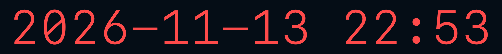
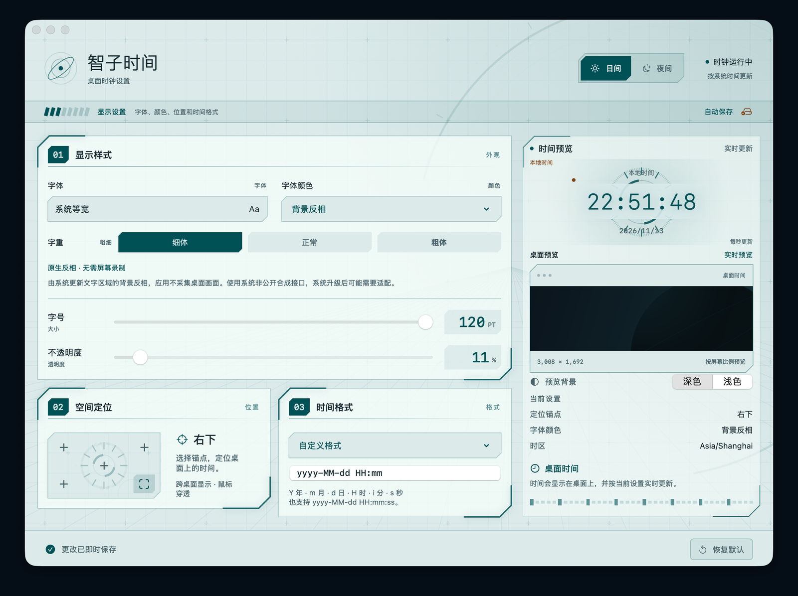

# 智子时间

一个运行在 macOS 桌面上的智子风格实时悬浮时钟。

应用启动后默认在主屏幕居中显示日期和时间。浮层使用跨 Space 的置顶面板，因此切换桌面或进入全屏应用时仍会显示；应用本身以菜单栏图标运行，不会在 Dock 中占位。

## 截图

桌面悬浮时钟：



设置界面：



## 开源发布

本项目使用 [MIT License](LICENSE) 发布。你可以免费使用、复制、修改、合并、发布、再许可或销售本项目的副本，但需要在副本中保留版权声明和许可证文本。

欢迎提交 Issue 和 Pull Request。项目通过 Swift Package Manager 使用 Sparkle 2；首次构建需要下载依赖。

仓库同时提供本地 DMG 打包、Sparkle 更新入口和 GitHub Actions Release DMG workflow。Developer ID 签名、公证和 Sparkle appcast 需要配置 Apple 证书、App Store Connect API key 与 EdDSA 私钥。桌面反相功能依赖非公开的 macOS 系统合成接口，系统升级后可能需要适配。

## 安装

### 下载 Release

从 [Releases](https://github.com/u1-fan/ZhiziTime/releases) 下载最新版本。Release workflow 为 Apple Silicon（`arm64`）和 Intel（`x86_64`）生成 DMG：

1. 下载对应架构的 `ZhiziTime-v1.0.1-macOS-<arch>.dmg`。
2. 打开 DMG，将 `ZhiziTime.app` 拖到 `Applications`。
3. 首次打开时，如果 macOS 提示无法验证开发者，请在 Finder 中右键应用，选择“打开”，再确认打开。
4. 已配置 Sparkle 的稳定公证版本会在菜单栏提供“检查更新…”。
5. 应用启动后会出现在菜单栏，并在桌面显示时间；通过菜单栏的“设置…”调整字体、颜色、位置和时间格式。

未配置 Developer ID 时，workflow 仍可生成未公证 DMG；macOS 可能要求用户在“系统设置 → 隐私与安全性”中允许首次打开。

## 运行要求

- macOS 13 或更高版本
- Swift 6.0 或更高版本（使用 Xcode 时需 Xcode 16 或更高版本）
- Python 3.9 或更高版本，用于本地应用打包、校验和安装
- [Task](https://taskfile.dev/)，用于执行 [Taskfile.yml](Taskfile.yml) 中的工作流

## 构建和运行

```bash
task                     # 显示任务列表
task macos:doctor        # 显示工具版本及 macOS SDK 路径
task macos:check         # 检查包结构并编译 debug 版本
task macos:test          # 运行 Swift 渲染回归测试和 macOS 工作流测试
task macos:build         # 只构建当前架构的 release 可执行文件
task macos:app           # 构建并打包 dist/ZhiziTime.app，使用临时签名并校验
task macos:dmg           # 构建版本化 DMG，并嵌入 Sparkle.framework
task release:prepare     # 更新 VERSION、README 和 CHANGELOG
task release-check       # 校验版本、Sparkle 和 Release workflow 元数据
task macos:verify        # 校验已有 .app，不构建或启动
task macos:install       # 将已有 .app 安装到 ~/Applications，不构建或启动
task macos:launch        # 打开已有 .app，最多等待 10 秒确认对应路径的进程
task macos:run           # 按顺序执行 macos:app、macos:launch
task macos:logs          # 持续查看应用的系统日志，按 Ctrl-C 退出
task macos:workflow:test # 用替身命令验证打包、安装回滚和启动判断
task macos:clean         # 删除仓库内的 .build 和 dist
```

所有任务仅在 macOS 上执行。从仓库子目录调用时，工作目录仍固定在仓库根目录。
`check`、`build` 和 `app` 不启动或停止应用，也不运行测试。`test` 按顺序运行 Swift 测试和工作流测试；也可以用 `swift test` 单独运行 Swift 测试。
SwiftPM release 配置启用 `ZHIZI_ENABLE_SPARKLE`，debug 构建不会启动更新器。`macos:app` 会在本地存在 SwiftPM Sparkle artifacts 时嵌入框架；`macos:dmg` 使用发布脚本组装 DMG、签名嵌套代码并生成 SHA-256。

`app` 在临时目录中组装应用，使用临时签名，再检查 Bundle ID、版本、可执行文件、图标、Sparkle 嵌入和签名。校验通过后才替换旧产物。产物只包含当前构建架构，供本机使用。

`install` 先校验已有产物，再复制到目标目录中的临时位置。复制或验签失败不会覆盖旧应用；替换后再次校验，失败则恢复旧应用。目标应用正在运行时拒绝替换，请先从菜单栏退出。打包也会拒绝替换正在运行的目标 `.app`。

可以指定安装目录和已有应用路径：

```bash
task macos:install INSTALL_DIR="/Applications"
task macos:install INSTALL_DIR="临时 安装" APP_DIR="dist/ZhiziTime.app"
task macos:launch APP_DIR="$HOME/Applications/ZhiziTime.app"
```

`BUILD_DIR` 默认为 `.build/release`，表示打包时读取可执行文件的目录，不改变 SwiftPM 构建位置；`APP_DIR` 默认为 `dist/ZhiziTime.app`，`INSTALL_DIR` 默认为 `~/Applications`。相对路径均以仓库根目录为基准，路径含空格或中文时需加引号。Task 命令行传入的变量优先于宿主同名环境变量；任务不透传 `--` 后的额外参数，也不自动提权。`clean` 只清理仓库内默认产物，不清理自定义路径或已安装应用。

`launch` 先校验应用，再通过绝对路径打开，并轮询该包内可执行文件对应的进程。确认进程存在不代表界面、菜单和跨 Space 行为已经通过验收。`logs` 只筛选进程名为 `ZhiziTime` 的系统日志；当前应用没有专门的日志埋点，可能没有输出。

不使用 Task 时，也可以先构建并打包，再通过应用包启动：

```bash
swift build -c release --product ZhiziTime
python3 scripts/macos.py package --binary .build/release/ZhiziTime --app dist/ZhiziTime.app
python3 scripts/macos.py launch --app dist/ZhiziTime.app
```

### Sparkle 配置

`Sources/ZhiziTime/Resources/VERSION` 是版本唯一来源。发布前运行：

```bash
task release:prepare -- 1.1.0
task release-check
```

要启用稳定版本自动更新，需要用 Sparkle 的 `generate_keys` 创建 EdDSA 密钥，将公钥保存为 `config/sparkle-public-key.txt`，将私钥保存为 GitHub Secret `SPARKLE_EDDSA_PRIVATE_KEY`。私钥不能提交到仓库。

也可以使用快捷命令：

```bash
task sparkle:keys                  # 从钥匙串初始化或刷新公钥文件
task sparkle:keys:check            # 检查公钥文件与钥匙串是否一致
task sparkle:keys:export-private -- "$TMPDIR/sparkle-private-key.txt"
```

私钥导出后只用于写入 GitHub Secret `SPARKLE_EDDSA_PRIVATE_KEY`，确认上传成功后立即删除导出文件。

GitHub Actions 还需要配置以下 Secrets 才能生成签名、公证 DMG 和 appcast：

- `DEVELOPER_ID_CERTIFICATE_BASE64`
- `DEVELOPER_ID_CERTIFICATE_PASSWORD`
- `APPLE_API_KEY_P8_BASE64`
- `APPLE_API_KEY_ID`
- `APPLE_API_ISSUER_ID`
- `SPARKLE_EDDSA_PRIVATE_KEY`（稳定版本必需）

从 GitHub Actions 的 **Release DMG** workflow 手动输入版本号和 prerelease 标志。稳定版本先执行检查、Developer ID 签名、公证、staple 和 appcast 生成，再发布为 latest；未公证版本和 prerelease 不进入生产 appcast。

发布完成后 workflow 会轮询两个公开 appcast，确认当前版本和对应架构 DMG 已经可下载；如果 GitHub 内容分发尚未更新，workflow 会等待并重试，超时则失败。

每次 push 或 Pull Request 还会运行 `CI` workflow，检查 GitHub Actions、Python 脚本和 Shell 脚本。

菜单栏中的时钟图标提供“设置…”“隐藏时间”“显示时间”和“退出”操作。应用默认在主屏幕居中显示时间，浮层不接收鼠标事件，因此不会挡住桌面上的正常操作。

设置页采用科幻观测终端风格，支持日间与夜间模式，并记住上次选择。可以调整字体、导入 `.ttf` / `.otf` 字体、细体/正常/粗体、颜色、字号、不透明度、五个屏幕位置及时间格式；所有设置即时保存。桌面反相由系统背景合成器处理文字区域，无需屏幕录制权限，不采集桌面图像；应用仅在文字或布局变化时更新文字遮罩。该功能依赖非公开的系统合成接口，系统升级后可能需要适配，接口不可用时请选择固定颜色。右侧按主屏幕比例预览桌面效果，预览背景可独立切换深浅。设置窗口激活时也可以通过 `⌘,` 再次打开设置。

界面规范见 [DESIGN.md](DESIGN.md)。

## 设计说明

- 日期、时分秒使用系统本地时区，并每秒更新。
- 透明浮层由 AppKit `NSPanel` 和原生文字视图渲染，SwiftUI 负责设置界面和桌面预览。
- `.canJoinAllSpaces` 和 `.fullScreenAuxiliary` 让浮层跨桌面和全屏空间显示。
- 菜单栏应用通过 `LSUIElement` 隐藏 Dock 图标。


## 官网

项目官网：[zhizi-time.u1.fan](https://zhizi-time.u1.fan/)。官网源码和静态照片位于 [`website/`](website/)，时间码以 `YYYY-MM-DD HH:MM:SS` 叠加在照片中央；发布下载入口见 [GitHub Releases](https://github.com/u1-fan/ZhiziTime/releases)。
